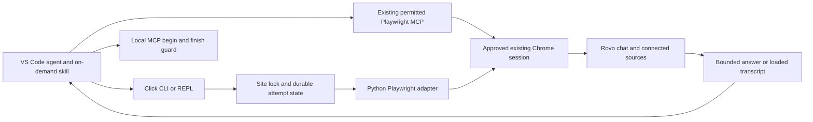

# Architecture and current boundaries

CLI-Anything supplies the development methodology and REPL presentation. The installed CLI does not run another coding model to generate tools at runtime. The adapter is Python-native and does not invoke the earlier Node prototype. Its upstream source is pinned in NOTICE.

## Request lifecycle

1. Validate the HTTPS Atlassian origin, expected email, session, prompt and optional PNG bytes. Source examples and fixtures use synthetic identities.
2. Acquire the site-level lock, inspect any prior uncertain delivery, connect to approved Chrome and find same-site tabs whose paths start `/jira/` or `/browse/`. Bind the only tab with a visible Rovo panel and verify the expected account. No eligible tab, no visible panel or multiple visible panels stops the operation. Keep the selected tab and enforce the same URL prefixes before submission and during response monitoring.
3. Resolve the same unique visible legacy or mini-modal root for discovery and operations. Hidden roots are ignored; multiple visible roots, including nested roots, are ambiguous. The mini-modal permits only account-bound status with one visible composer: `readiness: authenticated_ui_read_only` and `active_generation: null`. Ask, list and export stop with `rovo_layout_unverified`. Observed response-card/message-group selectors are compatible, but the mini-modal status label `Message sent.` is not terminal response evidence; generation, attachment-state handling and completion transitions remain unverified. Legacy sends require one visible enabled composer and an enabled New chat control when starting a conversation. Preserve existing drafts. Start a new chat or reopen a loaded conversation by its observed UUID; optionally verify GitHub source selection and image cards before sending.
4. Persist attempted-unknown state before clicking Submit once. Observe generation start, a response count above the baseline, the matching latest user prompt, exact completion status and no Stop generating button.
5. Save completion or timeout state, emit bounded JSON, release the lock and disconnect without closing the external Chrome browser or its tabs.

Completed means a response was obtained. It does not verify facts, prove GitHub retrieval or enforce read-only behavior. Uncertain delivery is never automatically resubmitted.

## Components

| Component | Responsibility |
|---|---|
| `rovo_cli.py` | Arguments, JSON, command dispatch and REPL |
| `core/state.py` | Validation, file bytes, locks, durable request records and completion predicate |
| `utils/rovo_backend.py` | Account/site binding, observed UI operations, response extraction |
| `utils/repl_skin.py` | Unmodified upstream CLI-Anything REPL presentation |
| `.github/skills/ask-rovo/SKILL.md` | Agent-facing invocation and authority limits |

The local request record stores destination/account/chat metadata, request ID and delivery status. It does not store the prompt or image body by default. Browser authentication remains in Chrome. Output and explicit exports may contain private information and must not be committed.

## Operational limits

English UI labels and observed DOM selectors are required. Site-level locking cannot stop unrelated browser clients. Fast replies whose generation start is missed fail conservatively. Some UI variants and error cases remain untested. Only loaded history is available, and new chat IDs are not automatically captured. The current export is text-only. No reliable context-percent meter, headless session provisioning, credit enforcement or automated recovery exists. The skill can select an existing MCP session before submission; it cannot recover uncertain delivery by switching transports.

The next-machine acceptance sequence is installation/doctor, account-bound status, one authorized prompt within available credits, then known-file retrieval on an account whose manual Rovo integration already works. No step implies organizational approval or enables broader access automatically.

## Agent-mediated MCP path

Automatic routing occurs in `/ask-rovo`, not inside the standalone CLI. A verified pre-submission direct connection block permits inspecting the existing MCP connection. Exact account/site, idle-composer and requested-capability checks precede any write. The agent prepares the turn, calls local `mcp begin` to persist a site-wide uncertain reservation, clicks Submit once through MCP, observes correlated completion and calls `mcp finish` with evidence. Missing/incomplete evidence stays blocked. `core/handoff.py` reuses the existing locks, atomic records, validation, completion predicate and output cap; `core/state.py` checks unresolved records across sessions and transports before any direct connection or new handoff.

The reserved record contains metadata, a prompt hash and response baseline, not prompt/image/answer bodies. The evidence file can contain private prompt and answer text and must remain outside Git. Completion evidence comes from the agent, so structural validation is not independent browser attestation. This path depends on actual Copilot tool access and skill compliance; it is not a direct MCP client, unattended service or policy bypass. Only offline tests have passed for this path.
