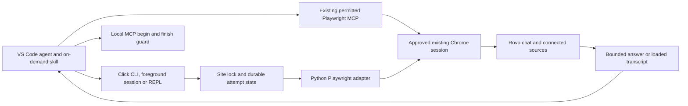

# Architecture and current boundaries

The canonical command is `rovo-relay-cli`; `rovo-relay` remains a compatibility alias. Both enter the same handlers and preserve the original `.cli-anything-rovo` state directory. The Python distribution remains `rovo-relay` for in-place upgrades.

CLI-Anything supplies the development methodology and REPL presentation. The installed CLI does not run another coding model to generate tools at runtime. The adapter is Python-native and does not invoke the earlier Node prototype. Its upstream source is pinned in NOTICE.

## Request lifecycle

1. Validate the HTTPS Atlassian origin, expected email, session, prompt and optional PNG bytes. Source examples and fixtures use synthetic identities.
2. Acquire the site-level lock and inspect prior uncertain delivery across sessions/transports before attachment. One-shot operations own a lazy approved Chrome connection; foreground sessions retain it. The owner creates one dedicated `/jira/for-you` tab per site/session/account, checks the expected account and opens Ask Rovo with a bounded readiness wait. Existing user tabs are not selected. Reuse the owned tab, replacing it only if closed after the delivery guard; reject navigation outside `/jira/` or `/browse/`. No reload, automatic reconnect or approval bypass occurs.
3. Resolve the same unique visible legacy or mini-modal root for discovery and operations. Hidden roots are ignored; multiple visible roots, including nested roots, are ambiguous. The mini-modal permits only account-bound status with one visible composer: `readiness: authenticated_ui_read_only` and `active_generation: null`. Ask, list and export stop with `rovo_layout_unverified`. Observed response-card/message-group selectors are compatible, but the mini-modal status label `Message sent.` is not terminal response evidence; generation, attachment-state handling and completion transitions remain unverified. Legacy sends require one visible enabled idle composer. For a new conversation, click New chat when enabled; skip a visible disabled button only with one visible welcome heading, no message groups or response cards and a visible disabled Submit button. Preserve existing drafts and refuse unverified states. The first ask or explicit `--new` starts a new chat; subsequent implicit asks reopen the session's saved UUID and compare the last-turn hash and loaded turn count before sending. Explicit `--chat` overrides selection. Capture new IDs by comparing loaded picker IDs before and after completion, requiring one new ID and a matching turn after reopening; optionally verify GitHub source selection and image cards before sending.
4. Persist attempted-unknown state before clicking Submit once. Observe generation start, a response count above the baseline, the matching latest user prompt, exact completion status and no Stop generating button.
5. Save completion before attempting ID capture. Store the verified chat ID, turn hash and loaded count in the same atomic request record. Capture failure retains the completed answer, marks continuity unavailable and blocks a future implicit follow-up. Old records lacking a verified binding also require explicit selection or `--new`; neither bypasses uncertain delivery. Save timeout state and release the lock. One-shot commands detach before returning; persistent sessions keep the connection between commands and detach at shutdown. Emit bounded JSON without closing external Chrome or user tabs; cleanup closes only verified empty idle owned tabs after status.

Completed means a response was obtained. It does not verify facts, prove GitHub retrieval or enforce read-only behavior. Uncertain delivery is never automatically resubmitted.

## Agent next action

Every direct status, ask and chat result, including preparation errors, carries `next`, computed by `next_action` in `core/state.py` from the same fields the guards already set: `ask` (ready, or a verified follow-up may be sent), `new_or_inspect` (continuity unbound, changed or unavailable; a completed answer is never resent), `mcp_fallback` (pre-submission `chrome_debugging_unavailable`), `fix_or_report` (nothing sent, CLI input error) and `stop` (blocked, uncertain, layout, browser, connection or authentication). It interprets results; it never relaxes a guard. MCP `begin/finish` keep their documented flow. The session's first line merges `version`, `implemented` and `mcp_handoff`. Completed operations include `timings_ms` for `attach`, `prepare`, `select`, `generate` and `capture` where reached; `attach` is near zero for a retained connection.

## Foreground session

`session` freezes site/account/request-session/dry-run policy, emits an initial status and reads JSON argv arrays from stdin. Existing Click handlers parse status, ask and chat commands; every result is schema 1 with a flushed `exit_code`. Help, MCP, nested sessions, global overrides and stdin prompt files are rejected. Invalid input or preparation errors are recoverable. Authentication failure, blocked delivery, interruption, lost connection and unsuccessful possibly-submitted operations terminate the stream. A completed ask can continue despite `retry_safe: false` without resending that turn. EOF triggers guarded owned-tab cleanup and detachment; dry-run session emits once without attachment or reading input.

`BrowserConnection` retains the Playwright runtime, browser connection and owned tab mapping. Panels, account and composer state are checked per operation; site locks are absent while waiting for input. The owner never retries attachment. SIGINT/SIGTERM unwind the foreground session or human REPL; shutdown detaches once and attempts runtime cleanup even if detach fails. Sanitized cleanup notices go to stderr without replacing results or altering request records. Copilot-host acceptance remains separate from development-Mac validation.

By default the owner uses Playwright's Chrome channel discovery. Global `--chrome-port` selects a verified existing-browser loopback port and connects directly to its approval-mode WebSocket, avoiding both the missing discovery-file dependency and unsupported HTTP JSON discovery. Click validates the port range; arbitrary hosts and endpoint paths are not accepted. The port is immutable for a retained owner. There is no guessed port, automatic endpoint fallback or approval bypass.

## Components

| Component | Responsibility |
|---|---|
| `rovo_cli.py` | Arguments, JSON, command dispatch and REPL |
| `core/state.py` | Validation, file bytes, locks, durable request records and completion predicate |
| `utils/rovo_backend.py` | Account/site binding, observed UI operations, response extraction |
| `utils/repl_skin.py` | Unmodified upstream CLI-Anything REPL presentation |
| `.github/skills/ask-rovo/SKILL.md` | Agent-facing invocation and authority limits |

The local request record stores destination/account/chat metadata, request ID and delivery status. It does not store the prompt or image body by default. Browser authentication remains in Chrome. Output and explicit exports may contain private information and must not be committed.

## Operational limits

English UI labels and observed DOM selectors are required. Site-level locking cannot stop unrelated browser clients. Fast replies whose generation start is missed fail conservatively. Some UI variants and error cases remain untested. Only loaded history is available. ID capture is bounded to loaded picker rows; missing/ambiguous capture or mismatched history blocks implicit continuity. The current export is text-only. No reliable context-percent meter, headless session provisioning, credit enforcement or automated recovery exists. The skill can select an existing MCP session before submission; it cannot recover uncertain delivery by switching transports.

The next-machine acceptance sequence is installation/doctor, account-bound status, one authorized prompt within available credits, then known-file retrieval on an account whose manual Rovo integration already works. No step implies organizational approval or enables broader access automatically.

## Agent-mediated MCP path

Automatic routing occurs in `/ask-rovo`, not inside the standalone CLI. A verified pre-submission direct connection block permits inspecting the existing MCP connection. Exact account/site, idle-composer and requested-capability checks precede any write. The agent prepares the turn, calls local `mcp begin` to persist a site-wide uncertain reservation, clicks Submit once through MCP, observes correlated completion and calls `mcp finish` with evidence. Missing/incomplete evidence stays blocked. `core/handoff.py` reuses the existing locks, atomic records, validation, completion predicate and output cap; `core/state.py` checks unresolved records across sessions and transports before any direct connection or new handoff.

The reserved record contains metadata, a prompt hash and response baseline, not prompt/image/answer bodies. The evidence file can contain private prompt and answer text and must remain outside Git. Completion evidence comes from the agent, so structural validation is not independent browser attestation. This path depends on actual Copilot tool access and skill compliance; it is not a direct MCP client, unattended service or policy bypass. Only offline tests have passed for this path.
